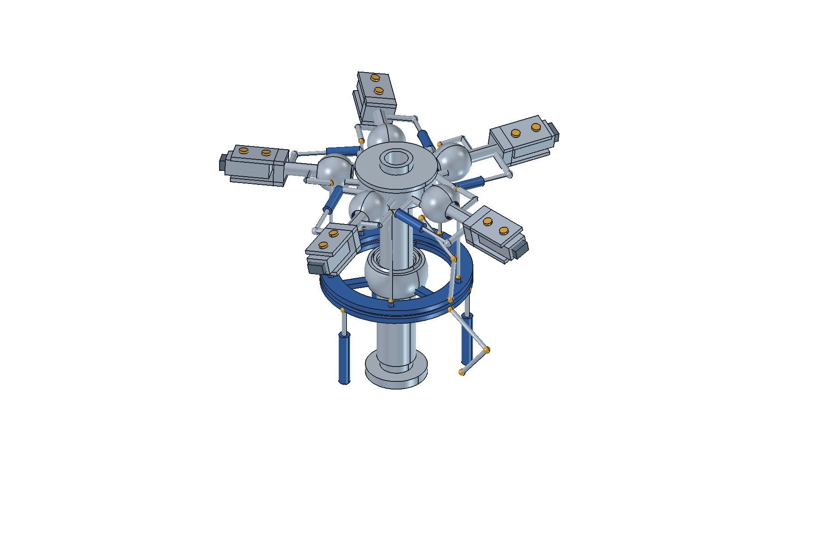

# Rotor CAD Benchmark — 要求仕様 v0.2

**[C1 / C2 比較サイト →](https://naoyamd.github.io/rotor-cad-benchmark/)**
[C1 初回設計](https://naoyamd.github.io/rotor-cad-benchmark/c1.html) と [C2 再設計](https://naoyamd.github.io/rotor-cad-benchmark/c2.html) を比較し、それぞれの実CAD・動作表示・検証資料を確認できます。C2はC1の不足を踏まえた再設計で、独立した同条件試行ではありません。表示の区別・検証方法は [サイトのREADME](docs/README.md) を参照してください。

実機の初期設計に引き継げる工学的な説明と、編集・再計算・検証できるCADアセンブリを、AIがどこまで自律的に構築できるかを評価する課題。

対象は **EH101 / AW101系の方式を参考にした、5枚ブレード・全関節型メインローターのオリジナル設計**。スワッシュプレート、弾性支持、リードラグダンパー、折畳み・飛行時ロックを含む。実機の複製、部品点数競争、見た目だけのモデル化は目的ではない。

**このリポジトリは設計要求と未完了の設計候補を収録しており、完成設計・製作図・耐空性の証明ではない。** 「初期設計に引き継げる」は、仮定・荷重・計算・形状・未解決事項が追跡できることを意味する。飛行可能性が検証済みという意味ではない。

## 再設計 C2（2026-10-25）

球面内外輪・フォーク・ピン・保持部、回り止め／回転同期、停止支持、折畳みロックを再設計。425形状フィーチャ・648ソリッドを4状態で保存し、主要継手の検査と12姿勢の実CAD動作画像を追加しました。形状フィーチャ数は製造部品数とは異なります。

**G0完了、G1〜G3未通過。要求28件は合格11・不合格1・未検証16で、実機の初期設計にそのまま使える目標には未達です。**

- [C2 成果物](results/C2/) / [一式ZIP](results/C2.zip) / [最終報告](results/C2/final-report.md)
- C2の時間・トークン・料金は本サイトでは未集計です。以下のC1集計に含めていません。

## 実行結果 C1（2026-10-25）

FreeCADによる5枚全長翼・145部品の設計候補を公開した。**G0完了、G1未通過、G2/G3未達**。要求28件の判定は合格11、不合格1、未検証16。材料強度・軸受容量・実関節・全作動域の干渉は未解決で、製作・飛行には使えない。

- [モデル・STEP・計算コード一式（ZIP）](results/C1.zip)
- [FreeCAD基準姿勢](results/C1/rotor-neutral.FCStd) / [収納姿勢](results/C1/rotor-folded.FCStd) / [STEP](results/C1/rotor-neutral.step)
- [設計・検証報告](results/C1/final-report.md) / [要求追跡表](results/C1/requirements.csv) / [再生成方法](results/C1/RUN.md)
- [実行時間・トークン・API料金試算](EXECUTION_REPORT.md)

評価した10,800ケースの最大ピッチ誤差は0.162°、収納幅は3.504 m。4姿勢のファイル再読込とSTEP照合を実施した。これらの部分検証を全要求の合格とは扱わない。

| 工程 | 記録上の承認/UI待ちを除いた時間 | 親＋子の総トークン | API Standardトークン料金試算 |
|---|---:|---:|---:|
| 仕様策定・レビュー | 23分23秒 | 7,400,181 | $6.22 |
| CAD作成 | 52分46秒 | 20,313,075 | $14.40 |
| 合計 | **1時間16分09秒** | **27,713,256** | **$20.62** |

API料金は記録されたキャッシュヒットを適用した仮定計算であり、実請求ではない。今回の集計・公開作業、別建てツール料金、税は対象外。除外した待ち区間、モデル別内訳、Fast料金、公式単価と再計算コードは[実行レポート](EXECUTION_REPORT.md)に記載。

## 別セッションで始める

1. このリポジトリを作業ディレクトリとして開く。
2. [HANDOFF.md](HANDOFF.md) の実行依頼を新しいチャットに貼る。
3. AIは要求を読み、設計基準案と粗い配置CADを反復する。G1で基準を整合させてから詳細CADと受入検証へ進む。

## 読む順番

| ファイル | 役割 |
|---|---|
| [DESIGN_REQUIREMENTS.md](DESIGN_REQUIREMENTS.md) | 目的、境界、必須要求と合否 |
| [DESIGN_BASIS.md](DESIGN_BASIS.md) | 参照事実、シナリオ、未決定量と決定手順 |
| [VERIFICATION.md](VERIFICATION.md) | 検証手順、証拠、採点、到達段階 |
| [HANDOFF.md](HANDOFF.md) | 次のAIへの実行指示 |
| [SOURCES.md](SOURCES.md) | 一次資料と引用範囲 |
| [REQUIREMENTS_REVIEW.md](REQUIREMENTS_REVIEW.md) | 要求の矛盾・抜け道に対するレビューと対応 |
| [templates/](templates/) | 設計基準・要求追跡・意思決定の記録様式 |

## 課題の難しさ

回転と非回転の境界で3成分の操縦入力を伝え、各翼のピッチ・フラップ・リードラグの結合を扱い、荷重を支え、さらに収納状態へ遷移させる。弾性支持を剛体関節に置き換えた場合の限界も説明する。これらを同じ形状・座標・寸法体系で整合させることを評価する。

自由な設計変数を多数残すため、これは唯一の正解形状を比較する課題ではない。標準実行はG1もAIが解く初期設計＋CADの課題である。CAD能力だけを比較する場合は、別途、同じ完成済みG1基準を全AIへ渡す。このリポジトリには完成済みG1基準は含まれない。前者では「要求解釈・初期設計」と「CAD実装」を分けて採点する。

要求の変更は削除によって隠さず、理由と影響を記録する。成立性に根拠がなければ、難度を上げるための寸法・角度・部品は追加しない。

仕様策定日: 2026-10-24（America/Los_Angeles）。文書は日本語、単位は原則SI、CAD長さ表示はmm。
